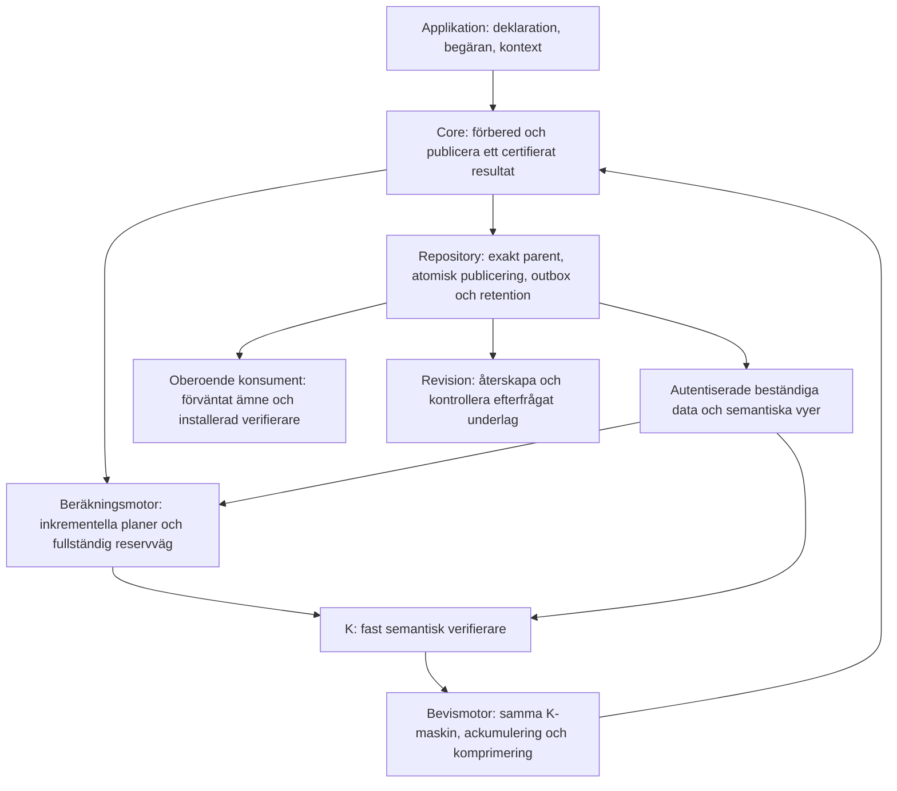

# En ny arkitektur för Core

Arkitekturbeslut, 2026-11-01. **Rekommenderad grund för nästa Core.** Detta är en
sammanhängande design, inte en implementerad eller uppmätt millisekundlösning.
Den bygger på [samtliga 13 undersökningar](evidence-and-decisions.md), tre nya
alternativ och deras jämförelse. Dagens implementation är semantisk referens;
dess representation och arbetsfördelning behöver inte följa med.

## Beslutet i enkla ord

Core ska komma ihåg **varför det befintliga tillståndet är korrekt**. När något
ändras ska den kontrollera ändringen och de konsekvenser som faktiskt följer av
den. Den ska inte bygga hela beslutsrapporten, kontrollera hela tillståndet eller
spela om hela historien igen för att återetablera samma kunskap.

En snabb beräkningsmotor föreslår resultatet och ett kontrollerbart underlag.
En liten, fast verifierare avgör om förslaget följer exakt Core-semantik.
Ett ackumulerat kryptografiskt bevis binder ihop starten och varje accepterad
övergång. Därmed kan en ny mottagare kontrollera historien utan att själv köra
alla gamla övergångar. Den stora revisionsrapporten återskapas när den efterfrågas.

Detta kräver en ny evidensversion. Vi behåller betydelsen av regler, resultat,
fel, kommandon och observationer. Gamla dokument och deras identiteter fortsätter
att använda sina gamla format och verifieringsregler.

## Härledning från första principer

1. **Korrekt betyder exakt rätt exekvering.** Ett annat resultat som också klarar
   säkerhetsreglerna räcker inte. Ordning, avrundning, mellanliggande overflow,
   första fel, överhoppade uttryck, samtidiga effekter och dubbla kommandon ingår.
2. **En kontrollerad uppgift behöver inte räknas fram igen utan anledning.**
   Återanvändning kräver ett bevis för att dess betydelse och alla relevanta
   beroenden fortfarande gäller. Okända beroenden räknas som påverkade.
3. **Verifieraren måste veta att inget saknas.** Äkta rader i ett svar bevisar
   inte att svaret är komplett. Tomma queries, nya medlemmar, inkommande referenser
   och utelämnade regler måste omfattas av kontrollen.
4. **Historisk giltighet är en kedja.** Starten etablerar invarianten; varje steg
   bevarar den; historikbeviset måste avse just dessa steg, identiteter och resultat.
   Separata bevis för en count, en hash och en liten krets etablerar inte kedjan.
5. **En representation ska bära den kunskap som nästa steg behöver.** Full text
   är ett möjligt exportformat, men behöver inte vara arbetsformat eller underlag
   för varje ny hash. Bevarade inputs och en entydig semantisk rekonstruktion kan
   binda samma observationsbetydelse med en ny identitetsalgoritm.
6. **Allt verkligt arbete har en kostnadsägare.** Import, kompilering, indexbygge,
   bevisproduktion, komprimering, slutkontroll, lagring och återställning räknas.
   Flytt till bakgrunden uppfyller inte ett löfte om ett färdigverifierat svar.

## Ansvar och gränser



**Semantiken och K** äger vad som räknas som korrekt. En formell specifikation
definierar hela det antagna språket. K har fasta regler för evaluering,
återanvändning, täckning, sammanfattningar, autentiserade läsningar och exakt
slutförande. En ny acceptansregel kräver en ny granskad och bevisad release.

**Beräkningsmotorn** äger hur ett bra underlag hittas. Den får använda härledda
förändringsprogram, queryplaner, kodgenerering och cache. Den är inte betrodd för
semantisk korrekthet. En fullständig producent kan alltid härleda vanlig
evaluering genom samma K för varje antagen konstruktion. Den vägen får vara dyr;
dess frekvens måste redovisas. Ett anrop till dagens Core utanför bevisrelationen
är ingen sådan reservväg.

**Datamodulen** äger autentiserade värden, beständiga uppdateringar och exakta
vyer. **Repository** äger fysisk lagring och den atomiska ordningen mellan
publiceringar. Det är en verklig adaptergräns: minnesadaptern lovar processlokal
atomicitet, en beständig referensadapter måste dessutom uppfylla ett namngivet
transaktions- och kraschkontrakt. Core öppnar inte godtyckliga nätanslutningar
under evaluering. Applikationen tillför explicit fångad kontext.

**Bevismotorn** intygar exekvering av samma K-maskin. Den får inte bevisa en
förenklad relation och sedan kräva full Core-återspelning för att knyta ihop
resultatet. **Den oberoende verifieraren** är en separat konsument med egen
installerad release, egna förväntade identiteter och egna tillitsankare.

Detta är ansvar inom en implementation, inte en samling publika plugin-API:er.
Vanliga användare ska inte välja kurvor, skapa vittnen eller ange vilka regler
de tycker har påverkats.

## Tillståndet som nästa steg får förlita sig på

Det logiska tillståndet är:

```text
Ω = (levande typade entiteter, alla använda identiteter,
     exakt härkomst och historik, aktiva deklarationer och profiler)
V = exakta härledda vyer och kontrollerade sammanfattningar
J(Ω,V) = varje vy är exakt den funktion av Ω som dess definition anger
```

V kan innehålla typmedlemskap, antal, inkommande referenser, ordnade queryindex,
beroenden och ordnade regleresultat. Ingen vy får bli en alternativ affärssanning.
Att en vy har en giltig hash räcker inte: dess likhet med definitionen etableras
vid start och bevaras av varje K-steg. Även ett beroendeindex omfattas av J.

Värden, mängden använda identiteter, semantiska sekvenser och händelser lagras i
immutabla autentiserade strukturer. Första strukturfamiljen är kanoniska
komprimerade radixträd över entydigt kodade typade nycklar, med kopiering av
ändrade sökvägar. Ordnade index har en bevisad ordningsbevarande nyckelkodning.
Trädform och nodkodning fastställs av profilen; databasens sidlayout påverkar
inte den logiska roten. Kostnaden uttrycks i faktiskt öppnade noder och
nyckellängd, inte som ett obetingat löfte om O(log N).

Tillståndsinnehåll, historisk position och hjälpdata får olika identiteter.
En kommandobärande händelse kan ändra historiken utan att ändra entiteterna.
Radering tar inte bort identiteten ur mängden redan använda identiteter.
Få levande entiteter innebär därför inte begränsad livstidslagring.

## Ett litet publikt gränssnitt

Följande är kontraktsskiss, inte nya befintliga Rust-funktioner:

```text
installed = Core.install(full_module, release, deployment_contract)
session   = Core.open(installed, repository, Genesis | Import | CertifiedHead)
result    = session.execute(expected_parent, request_id, request, captured_context)
answer    = session.read(expected_head, read_request, captured_context)
status    = session.resolve(request_id, original_request_digest)

check     = Verifier.verify(expected_claim, certificate)
stream    = session.export_audit(exact_range, requested_profile)
audit     = Verifier.audit(expected_claim, stream)
```

`install` antar hela deklarationen och härleder/checkar dess fullständiga
regel- och beroendeinventering. En optimeringsplan kan bytas utan att ändra
programmets betydelse. Planens resursbehov och kända dyra fall ska gå att inspektera.

`execute` skiljer mellan `Committed(receipt)`, ett exakt semantiskt avslag/fel
vid angiven parent, `Conflict`, `Unavailable`, `ResourceFailure` och
`UnknownCommitStatus`. Resursfel får inte förvandlas till affärsmässigt avslag.
Efter osäker publicering får man inte påstå att transaktionen rullades tillbaka.
`read` binder svaret till angivet head och input; den skapar ingen affärshändelse.
Ett certifierat avslag eller lässvar är en separat bevisad försöksutsaga vid
denna parent, inte ett nytt steg i den publicerade händelseloggen.
`execute` bevarar även certifierade avslag under samma atomiskt unika request-ID
så att en retry kan upplösas till originalsvaret.

Standardkontraktet är synkront: ett certifierat svar omfattar bevisproduktion,
komprimering och oberoende slutkontroll. `Committed` omfattar dessutom beständig
publicering. Ingen dold övergång till asynkron certifiering tillåts om detta blir
för långsamt. Det är då arkitekturens latensmål som har misslyckats.

## Arbetsgången

**Start:** En tom genesis eller full import kontrolleras, J etableras och ett
startbevis produceras. En tidigare certifierad rot kan öppnas genom kontroll av
dess exakta certifikat och autentiserad hämtning av behövliga data. Detta slipper
en ny total genomläsning, men gör inte den ursprungliga importen gratis.

**Övergång:** Motorn läser nödvändiga autentiserade data och föreslår en exakt
delta med härledning. K kontrollerar nya fakta, ändrade sökvägar och komplett
påverkan. Opåverkade sammanfattningar återanvänds under sina bevisade villkor.
Bevismotorn ackumulerar dessa K-steg och producerar det färdiga certifikatet.

**Publicering:** Efter oberoende slutkontroll gör Repository en atomisk jämförelse
med exakt parent och aktiveringskoordinat. Nya rötter, händelse, certifikat,
request-resultat, retention och outbox blir synliga tillsammans. Först då
returneras `Committed`. En giltig förlorande gren är inte kanonisk historik.

**Ny historikkonsument:** Konsumenten kontrollerar ett komprimerat bevis mot
förväntad genesis, deklaration, release, profil, position och slutpunkt.
Inget fullständigt Core-återspel får krävas som semantisk brygga.

**Revision:** Den som vill läsa alla detaljer begär dem explicit. Core återskapar
hela den utlovade observationen och verifierar underlagets integritet.
Saknade data rapporteras. Ett historikbevis ersätter inte en full datagranskning.

## Ny evidensprofil: bind betydelsen, bygg texten vid behov

En normativ händelse binder exakt parent, fullständig modulidentitet inklusive
observationsrelevant metadata, begäran, fångad kontext, valt resultat, effekter
och ordnade kommandohändelser. Dess **observationsrecept** namnger den exakta
deterministiska evaluerings-/observationsprofilen och dessa bundna indata.
Det bestämmer hela observationen entydigt. K bevisar det exakta utfallet enligt
den profilen; revisionsfunktionen kan återskapa observationen från receptet och
bevarat underlag. Delade observationskroppar kan påskynda detta.

Receptet är ett medvetet nytt åtagandekontrakt. Det är inte SHA-256 av gammal
utvecklad JSON. Händelseidentiteten får inte bero på cacheträffar, vald queryplan,
vittnets form, bevisrandomisering eller hjälpvyer. Hjälprots- och
certifikatidentiteter hålls separata och bevisas representera rätt semantiska
tillstånd. Två korrekta motorer med samma semantiska inputs ska få samma
händelseidentitet även om deras kontrollunderlag ser olika ut.

Parent i händelsehashen är en uttryckligt semantisk parent utan hjälprötter eller
certifikat. Händelsen binder ordnade kommandoavsikter/payloads; därefter härleds
förekomst-ID som `(EventId, ordinal)`. Den binder alltså inte sitt eget ännu
oberäknade ID via kommandona. Den exakta [acykliska konstruktionen](correctness.md)
ingår i profilkontraktet.

Gamla prefix kan införlivas genom en uttrycklig, engångskontrollerad
adoptionsgräns. Kontrollen av det gamla prefixet och dess identiteter betalas där.
Ett betrott snapshot utan den kontrollen ger en ny betrodd startpunkt och bevisar
bara fortsättningen. Nya identiteter märks med ny profil; gamla kommando-ID:n
skrivs inte om som om de vore samma.

## Varför denna arkitektur framför de andra?

| Alternativ | Styrka | Avgörande kostnad eller risk | Beslut |
| --- | --- | --- | --- |
| [Fast semantisk maskin](../../research/core-architecture-20261101/candidates/semantic-kernel.md) | Enhetlig språktäckning och få semantiska översättningar. | Lägger strategi och bred tolkning i den betrodda vägen; risk för mycket bevisarbete. | Använd dess fullständiga härledningsväg som producent och referens. |
| [Certifierad förändringskompilator](../../research/core-architecture-20261101/candidates/delta-compiler.md) | Härleder effektivt underhåll av många vyer. | En fullständigt bevisad kompilator för hela ordnade, partiella Core-språket är ett mycket stort beroende. | Använd förändringsprogram för att producera underlag; K checkar alla använda lagar och täckning. |
| [Liten övergångsverifierare](../../research/core-architecture-20261101/candidates/certified-transition.md) | Skiljer optimering från acceptans och ger en gemensam relation att ackumulera. | Kräver komplett och effektiv K, maskinmotsvarighet och dyrt synkront bevisarbete tills motsatsen visats. | **Välj som arkitekturens auktoritet.** |

Det är inte tre parallella sanningar. Endast K får acceptera en övergång.
Kompilatorn och den fullständiga producenten är två sätt att hitta härledningar
för samma regler. Autentiserade strukturer behövs för gles kontroll av stora
tillstånd; ackumulering behövs för historik utan återspel. De löser olika
nödvändiga delar av kedjan.

## Vad beslutet åstadkommer och vad som återstår

Arbetsformen ändras från upprepad total materialisering till **bevisat underhåll
av semantisk kunskap**. Den tar bort tre identifierade orsaker till tillväxt:
fullständiga J-kontroller vid varje steg, full beslutsrapport som arbetsformat och
historisk återspelning vid varje ny verifiering.

Det finns ingen visad absolut latens för denna nya sammansättning. Synkron
bevisproduktion är den största öppna prestandarisken. Global påverkan kan kräva
globalt arbete. Godtycklig import och full export kan inte göras oberoende av
datamängden. Dessa begränsningar måste synas i samma redovisning som den snabba vägen.

Byggbeslutet konkretiseras i [korrekthetskontraktet](correctness.md),
[kostnads- och bygggrindarna](validation-and-cost.md) och
[evidens till arkitekturbeslut](evidence-and-decisions.md).
